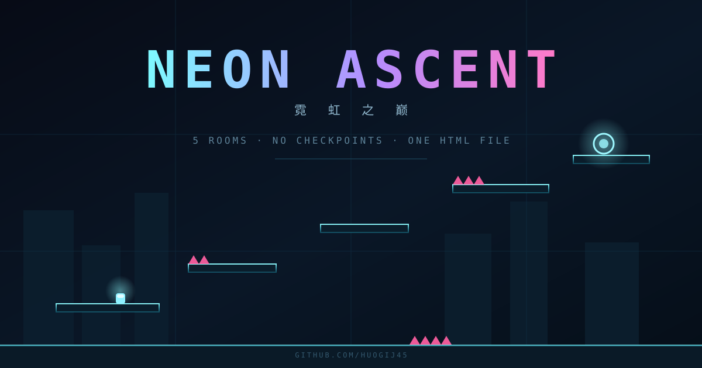

# 霓虹之巅 · NEON ASCENT

> 一款**单文件**、零依赖、打开即玩的硬核精准平台跳跃游戏。
> 5 个房间，一次失误就重来 —— 你的每一次死亡都会被计数。



<p align="center">
  <em>「没有存档点，也没有原谅。」</em>
</p>

---

## 这是什么

一个 50KB 的 `index.html`：没有引擎、没有 npm、没有构建步骤。
双击打开，或者丢到任意静态托管上，就能开始爬塔。

- **硬核精准跳跃**：受击即死、坠落即死，每次重生都从房间起点开始。
- **手感优先**：惯性移动、可变跳跃高度、土狼时间、跳跃缓冲、墙滑、墙蹬、八方向冲刺 ——
  该有的细节一个不少，但只为服务「跳得准」这一件事。
- **残影系统**：每个房间都会存下你的最佳记录，并以半透明残影同步回放，
  你能亲眼看着自己上一次的最佳路线在旁边跑。
- **真·手速排行榜**：金 / 银 / 铜奖牌按各房间 par 时间结算。

## 怎么玩

| 操作 | 键盘 |
| --- | --- |
| 左右移动 | `←` `→` / `A` `D` |
| 跳跃（按住更高） | `Z` / `空格` / `K` / `Enter` |
| 冲刺（八方向） | `X` / `Shift` / `J` |
| 重开本房间 | `R` |
| 暂停 | `P` / `Esc` |
| 静音 | `M` |

移动端自动出现虚拟摇杆按键（◀ ▶ ⚡ ▲），右下角预留了拇指区。

**核心技巧**

1. **跳跃要按住**：轻点是短跳（35px），按住 20 帧才能拿到完整的 45px 高度。
2. **冲刺会补满**：落地或蹬墙后冲刺次数立即恢复 —— 所以「跳 → 冲刺 → 蹬墙 → 再冲刺」是长距离移动的标准套路。
3. **墙蹬是垂直通道的钥匙**：贴墙下滑时按跳跃会向反方向弹开，配合方向键可以一节一节地把竖井爬穿。
4. **土狼时间 6 帧**：走出平台边缘后还有 100ms 可以起跳，别怕贴边。

## 五个房间

| # | 房间 | 主题 | 通关要点 |
| --- | --- | --- | --- |
| 01 | 第一缕光 FIRST LIGHT | 基础跳跃 | 5 级上升平台，越过两组地面尖刺 |
| 02 | 断裂带 FAULT LINE | 冲刺位移 | 4 道深坑，每组缺口必须「跳 + 冲」才够得着 |
| 03 | 攀壁 THE SHAFT | 墙蹬 | 3 格宽的竖井，靠左右交替蹬墙爬到顶端传送门 |
| 04 | 针尖 NEEDLE | 极限间距 | 天花板尖刺下的平台间距被压到刚好一跳 |
| 05 | 天顶 ZENITH | 综合 | 竖井 → 悬空阶梯 → 终点，全程没有安全区 |

## 技术细节

- 逻辑分辨率 `640×360`（32×18 格，格 20px），画布 2 倍超采样，实际铺满 `1280×720`。
- 固定 60Hz 步进 `stepSim()`，与帧率解耦，慢机器上也不会「跳得更远」。
- 物理：`grav 0.30 / maxFall 8.5 / maxRun 2.8 / jumpV -5.6 / dashV 6.6`，全部写在顶部的 `C` 常量里，改一个数就能改手感。
- 全部音效用 `WebAudio` 现场合成（无音频文件）；全部画面用 Canvas 2D 手绘（无图片资源）。
- 存档走 `localStorage`：最佳时间、残影轨迹、死亡总数、奖牌。
- 无外部依赖、无网络请求、无追踪。

想改关卡？搜索 `/*LEVELS_START*/` 到 `/*LEVELS_END*/` 之间的 5 个对象即可，
`solids` / `spikes` / `start` / `goal` / `par` 全部用格子坐标描述。

## 本地运行

```bash
git clone https://github.com/huogij45/neon-ascent.git
cd neon-ascent
open index.html        # macOS
# 或者
python3 -m http.server 8000   # 然后访问 http://localhost:8000
```

## License

[MIT](./LICENSE) © 2026 浩赟
